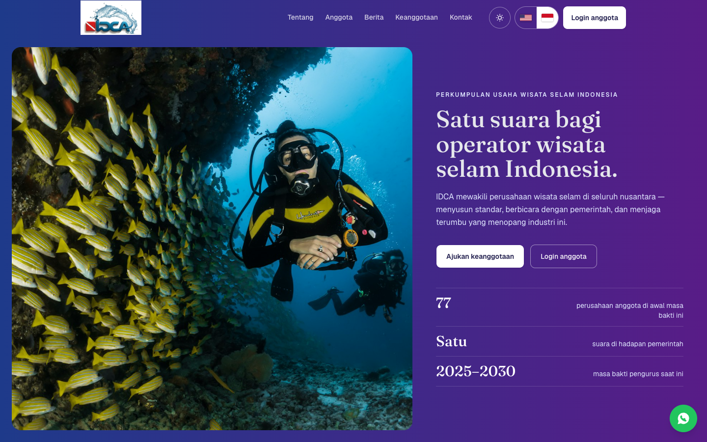
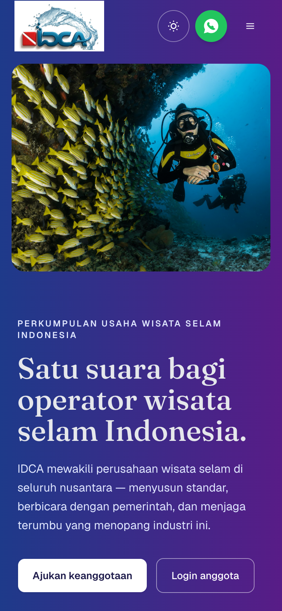

# IDCA Website

Website for the Indonesia Divetourism Company Association (IDCA / PUWSI), built with Astro and EmDash. The site is bilingual: English at `/` and Indonesian under `/id`.

## Screenshots

**Laptop (1440 px)**



**Mobile (390 px)**



## Stack

- **Astro** (server output, Cloudflare adapter) for pages and routing
- **EmDash** CMS for members, activities, and news. Production content is stored in Cloudflare D1 and photos in R2. The admin is at `/_emdash/admin`
- **Tailwind CSS v4** and **shadcn/ui** (`base-nova` style) for styling and components
- **React** only for the shadcn components that need client behavior

## Requirements

- Node.js 22.23.4 or newer
- npm

## Getting started

```bash
npm install
npm run dev
```

Open `http://localhost:4321`. Use `localhost` rather than `127.0.0.1`, because passkey sign-in in the EmDash admin needs a secure origin.

Local development uses a local copy of the D1 database and R2 bucket. The production site is https://idca.primayuda.dev.

### First-time CMS setup

Run this once for local development:

1. Open `http://localhost:4321/_emdash/admin/setup`.
2. Create the admin account and register a passkey.
3. Sign in at `/_emdash/admin` to edit members, activities, and news.

Run it once for production too, at `https://idca.primayuda.dev/_emdash/admin/setup`. Passkeys are tied to the domain, so register them on the production address. In the setup wizard, choose to load the sample content.

Photos are uploaded through the admin and stored in R2. If a photo is missing on the live site, check that its file exists in the `idca-media` bucket.

## Scripts

| Command | What it does |
| --- | --- |
| `npm run dev` | Start the development server |
| `npm run build` | Build the site into `dist/` |
| `npm run preview` | Preview the production build |
| `npm run deploy` | Build and deploy to Cloudflare from this machine |
| `npm run typecheck` | Run `astro check` |

## Deploy

Pushes to `main` build the site and deploy it to https://idca.primayuda.dev through `.github/workflows/deploy.yml`. The run is listed under the repository's **Actions** tab.

The workflow needs two repository secrets:

- `CLOUDFLARE_API_TOKEN`: a token created from the **Edit Cloudflare Workers** template, scoped to this account and the `primayuda.dev` zone
- `CLOUDFLARE_ACCOUNT_ID`: `b52da01e364b9fa39cb2de0df31532a2`

The Worker is `idca-website` and uses the D1 database `idca-website`, the R2 bucket `idca-media`, a KV session store, and a scheduled task every minute that publishes scheduled items. Its `workers.dev` address is turned off, so the site is reachable only at the custom domain.

To deploy from your own machine instead, sign in once with `npx wrangler login` and run `npm run deploy`.

## Languages

- English is the default and uses unprefixed paths (`/members`).
- Indonesian uses the `/id` prefix (`/id/members`).
- First-time visitors are sent to Indonesian. Their choice is kept in the `idca-locale` cookie, so later visits open in the same language.
- The old `/en` paths redirect permanently to the unprefixed English paths.

## Themes

- The site opens in dark mode by default.
- The sun/moon button in the header switches between dark and light. The choice is stored in the `idca-theme` cookie, so it is kept on later visits.

## Project layout

```
src/
  components/   Header, Footer, MailForm, MemberCard, Icons, shadcn UI in ui/
  layouts/      Base page shell
  lib/          Copy (EN/ID strings), locale helpers, site contact details, CMS field helpers
  middleware.ts Language redirects and the locale cookie
  pages/        Routes for English (root) and Indonesian (id/)
  views/        Page templates shared by both languages
  styles/       Global CSS and theme tokens
  worker.ts     Cloudflare Worker entry (scheduled publishing and co-editing rooms)
wrangler.jsonc  Cloudflare Worker, D1, R2, KV, and cron configuration
.github/        Deploy workflow (.github/workflows/deploy.yml)
seed/           Initial CMS content (seed.json) and media
scripts/        build-seed.mjs, which regenerates seed/seed.json
public/         Static assets (logos, photos, favicon)
```

## Content editing

Members, activities, and news are managed in the EmDash admin, so non-technical staff do not need to edit code. The contact details and copy that are not in the CMS live in `src/lib/site.ts` and `src/lib/copy.ts`.

Member regions (Raja Ampat, Komodo, Bali, Sulawesi, Banda Sea, Jabodetabek, Other regions) are a select field on the members collection. To add a region, add it to that field in the CMS and to `regionOptions` in `src/lib/locale.ts`, with an Indonesian label in `regionId`. The same list is kept in `scripts/build-seed.mjs` and `seed/seed.json` for new setups.

Membership and contact forms do not store submissions. They open the visitor's email app addressed to the IDCA mailbox.

## Notes

- `.env`, `.wrangler/`, `dist/`, `.dev.vars`, and `node_modules/` are local and git-ignored. Local development data is kept in `.wrangler/`, separate from production.
- The `mockup/` folder holds the original static design files for reference only and is git-ignored.
- The shadcn CLI is not installed as a dependency. Add new components with `npx shadcn@latest add <component>`. Its base CSS is kept in `src/styles/shadcn.css`.
